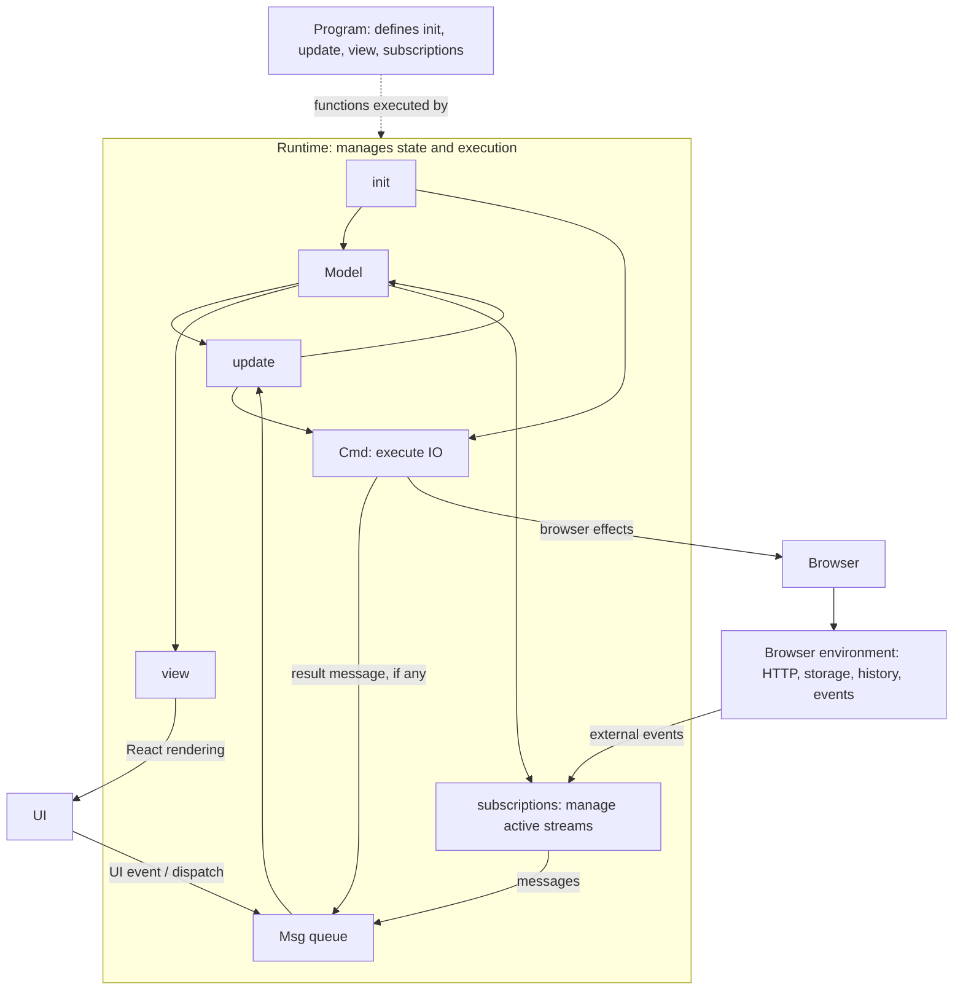
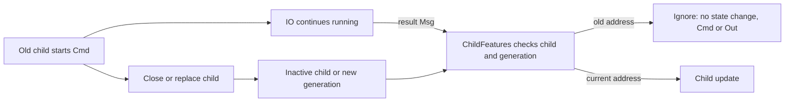

# Scalafui (Functional UI in Scala.js)

Scalafui is an experimental implementation of the Elm Architecture in Scala.js.

* [The Elm Architecture · An Introduction to Elm](https://guide.elm-lang.org/architecture/)
* [Functional UI \(Framework\-Free at Last\)](https://www.infoq.com/articles/functional-UI-introduction-no-framework/)

## Minimal Application Code

The following code is an example of a minimal application implementation using Scalafui.

```scala
import scala.scalajs.LinkingInfo
import org.scalajs.dom
import org.scalajs.dom.URL

import com.softwaremill.quicklens._

import slinky.core.facade.ReactElement
import slinky.hot
import slinky.web.html._

import cats.effect.IO
import cats.effect.unsafe.implicits.global

import marubinotto.fui._

object Main {

  //
  // MODEL
  //

  case class Model(messages: Seq[String] = Seq.empty, input: String = "")

  def init(url: URL): (Model, Cmd[Msg]) = (Model(), Cmd.none)

  //
  // UPDATE
  //

  sealed trait Msg
  case class Input(input: String) extends Msg
  case object Send extends Msg

  def update(msg: Msg, model: Model): (Model, Cmd[Msg]) =
    msg match {
      case Input(input) =>
        (
          model.modify(_.input).setTo(input),
          Cmd.none
        )

      case Send =>
        (
          model
            .modify(_.messages).using(_ :+ model.input)
            .modify(_.input).setTo(""),
          Cmd.none
        )
    }

  //
  // VIEW
  //

  def view(model: Model, dispatch: Msg => Unit): ReactElement =
    div(
      h1("Welcome to Scalafui!"),
      form(className := "message-input")(
        input(
          value := model.input,
          onInput := (e => dispatch(Input(e.target.value)))
        ),
        button(
          `type` := "submit",
          onClick := (e => {
            e.preventDefault()
            dispatch(Send)
          })
        )("Send")
      ),
      div(className := "messages")(
        model.messages.map(div(className := "message")(_))
      )
    )

  def main(args: Array[String]): Unit =
    run.unsafeRunAndForget()

  def run: IO[Unit] =
    IO {
      if (LinkingInfo.developmentMode) {
        hot.initialize()
      }
    } *> {
      Browser.run(
        dom.document.getElementById("app"),
        Program(init, view, update)
      )
    }
}
```


## Running Examples

* Requirements
    * [sbt](https://www.scala-sbt.org/)
    * [Node.js](https://nodejs.org/en/download/releases) 22.22.2+ (22.x), 24.15.0+ (24.x), or 26+ for the repository root and tests
    * [Yarn](https://yarnpkg.com/) Classic 1.22.x

### Hello World

* [src/main/scala/Main.scala](src/main/scala/Main.scala)

In development mode, use two terminals in parallel:

```console
$ yarn
$ yarn run dev
```

```console
sbt> ~fastLinkJS
```

### ToDo

* Scalafui's version of [TodoMVC](https://todomvc.com/)
* [examples/todo/src/main/scala/todo/Main.scala](examples/todo/src/main/scala/todo/Main.scala)

```console
$ cd examples/todo
$ yarn
$ yarn run dev
```

```console
sbt> ~exampleTodo/fastLinkJS
```

### Multipage

* Multi-page application with [Ajax calls](examples/multipage/src/main/scala/multipage/Server.scala)
* Debounce Search Cmd 
* [examples/multipage/src/main/scala/multipage/Main.scala](examples/multipage/src/main/scala/multipage/Main.scala)

```console
$ cd examples/multipage
$ yarn
$ yarn run dev
```

```console
sbt> ~exampleMultipage/fastLinkJS
```

### Stopwatch

* An example of subscription which allows us to listen to external events
* [examples/stopwatch/src/main/scala/stopwatch/Main.scala](examples/stopwatch/src/main/scala/stopwatch/Main.scala)

```console
$ cd examples/stopwatch
$ yarn
$ yarn run dev
```

```console
sbt> ~exampleStopwatch/fastLinkJS
```

### fuidungeon

A small turn-based dungeon RPG with randomly generated rooms and corridors and
an automatically following camera. Carry your health between floors and see how
deep you can descend. Demonstrates pure game rules, immutable
state, and random initialization through `Cmd`.

See the [fuidungeon README](examples/fuidungeon/README.md) for setup, controls,
game rules, and development instructions.


## Scalafui's basic concepts

Scalafui separates an application's definition from its execution. `Program`
defines how state changes and how it is displayed. `Runtime` holds the current
state and runs the application. `Browser` provides effects for interacting with
the browser, such as HTTP requests, storage, and navigation.



Follow the loop from a UI event: a message enters the queue, `update` produces a
new Model, and `view` describes the resulting UI. Commands and subscriptions feed
messages back into the same loop. The nodes inside Runtime execute the functions
and effect descriptions supplied by Program; Program itself does not run them.
Browser effects are one source of command work; commands can use other `IO`
computations too.

### Program

`Program[Model, Msg]` brings together the functions that describe an application:

```scala
Program(
  init = init,
  view = view,
  update = update,
  subscriptions = subscriptions,
  onUrlChange = Some(UrlChanged.apply)
)
```

The names on the right refer to application-defined functions and a message
constructor. Only `init`, `view`, and `update` are required. Subscriptions default
to `Sub.Empty`, and URL change handling defaults to `None`.

#### Model/View/Update

- **Model** is the application's state, usually an immutable case class.
- **Msg** describes something that happened, such as input, a button click, or a
  completed request.
- **View** turns the current Model into a Slinky `ReactElement`. Event handlers
  use the supplied `dispatch: Msg => Unit` to send messages.
- **Update** receives a message and the current Model, and returns the next Model
  together with commands to execute.

The application supplies these function signatures:

```scala
def init(url: URL): (Model, Cmd[Msg])
def view(model: Model, dispatch: Msg => Unit): ReactElement
def update(msg: Msg, model: Model): (Model, Cmd[Msg])
```

`init` receives the current browser URL and supplies the initial state and startup
commands. Keep state transitions in `update` and describe side effects as commands.
Return `Cmd.none` when no effect is needed. The minimal application above shows
this loop using input and send messages.

#### Commands

A `Cmd[Msg]` describes work for Runtime to execute once, optionally returning a
message. For example, an update can return a loading state and a command that
fetches data; the command's result becomes a new message that updates the state.

Compose effects with Cats Effect `IO`, then choose how to notify the application:

- `.toCmd` emits the computed value as a message. It is available through
  `import marubinotto.fui.*`; there is no implicit conversion.
- `Cmd.exec(io)` runs the effect without emitting a message.
- `Cmd.optional(io)` emits a message only when the result is `Some(message)`.
- `Cmd.none` is an empty batch of commands.

```scala
import cats.effect.IO
import marubinotto.fui.*
import scala.concurrent.duration.*

case class SearchCompleted(result: String)

def search(query: String): IO[String] = IO.pure(query) // Example computation.
def saveDraft: IO[Unit] = IO.unit

val operation = saveDraft *> search("scala")
val command = operation.map(SearchCompleted.apply).toCmd
val save = Cmd.exec(saveDraft)
val optional = Cmd.optional(search("scala").map(result =>
  Option.when(result.nonEmpty)(SearchCompleted(result))
))

val commands = Cmd.Batch(
  search("scala").map(SearchCompleted.apply).toCmd.debounce("search", 500.millis),
  save
)
```

These constructors are lazy: creating a command does not execute its IO. They
preserve IO errors and cancellation. `.toCmd` on `IO[Option[A]]` emits the Option
itself, including `None`; on `IO[Unit]` it emits Unit. Use `Cmd.optional` or
`Cmd.exec` when those results should not produce messages. To turn an IO failure
into an application message, handle it in the IO before converting to a command,
for example with `attempt.map(ResultReceived.apply).toCmd`.

`Cmd.fromFuture(futureExpression)` takes its argument by name and evaluates it
on each command execution, emitting `Right(value)` on success or `Left(error)`
for a failed Future or a synchronous exception while creating it. Constructing
the command does not evaluate the expression. Passing an already-created Future
cannot defer its start; repeated executions then reuse that same Future.
Canceling the command does not cancel the underlying Future.

Use IO `flatMap` for dependent steps and Cats `sequence` / `parSequence` for
sequential / parallel computations whose results should be collected into one
message. `Cmd.Batch` runs commands independently, emitting results as they finish;
completion order is not guaranteed. Commands can also be combined with `++`, and
batches support append/prepend operations. `map` transforms emitted messages;
`toNone` on a single command suppresses its message.

Debounce applies to a single command and takes a `FiniteDuration`, such as
`500.millis`. A new command replaces pending work with the same key, but does not
cancel work that has already started. Zero or negative delays do not wait.
Compose the IO first, then attach debounce; extracting `.io` from a command loses
its debounce policy. `map` and `toNone` preserve the policy. Runtime cancels
pending debounce waits when it is released.

#### Subscriptions

A `Sub[Msg]` describes an external event source that Runtime should listen to
while it is needed. `subscriptions: Model => Sub[Msg]` selects those sources from
the current Model. Unlike a command, a subscription can keep producing messages
across many updates.

```scala
import marubinotto.fui.*
import scala.concurrent.duration.*

case class Model(running: Boolean)
case class Tick(epochMillis: Long)

def subscriptions(model: Model): Sub[Tick] =
  if (model.running) Sub.every(1.second, "clock").map(Tick.apply)
  else Sub.Empty
```

`Sub.every` emits Unix epoch milliseconds using `Clock[IO].realTime`.
`Sub.timeout(duration, msg, id)` emits once after a delay; `Sub.fromEvent` adapts
DOM events. Combine sources with `combine`, or use `Sub.Impl(id, stream)` for an
`fs2.Stream[IO, Msg]`.

For callback APIs, `Sub.fromResource` takes a registration function returning a
`Resource[IO, Unit]`. Registration starts when the subscription stream runs;
events emitted during registration are retained. The resource is released when
the stream ends, fails, or is canceled, before its callback Dispatcher is released.
Compose resources to safely register multiple sources:

```scala
import cats.effect.{IO, Resource}
import marubinotto.fui.*

def externalSources[Msg](
    registerFirst: (Msg => Unit) => (() => Unit),
    registerSecond: (Msg => Unit) => (() => Unit)
): Sub[Msg] =
  Sub.fromResource[Msg]("external-sources") { emit =>
    for {
      _ <- Resource.make(IO(registerFirst(emit)))(unregister => IO(unregister()))
      _ <- Resource.make(IO(registerSecond(emit)))(unregister => IO(unregister()))
    } yield ()
  }
```

If the second registration fails, the first is released. On normal teardown,
resources are released in reverse acquisition order, even if a finalizer fails.
Each acquisition must still clean up any partial work it performs before failing.

A single callback API returning an unregister function can be adapted with
`Resource.make`. Its acquisition is uncancelable: cancellation during registration
waits for acquisition to finish and then runs cleanup.

```scala
import cats.effect.{IO, Resource}
import marubinotto.fui.*

def externalEvents[Msg](register: (Msg => Unit) => (() => Unit)): Sub[Msg] =
  Sub.fromResource[Msg]("external-events") { emit =>
    Resource.make(IO(register(emit)))(unregister => IO(unregister())).map(_ => ())
  }
```

Runtime compares subscription IDs after each update. New IDs start streams;
removed IDs cancel streams and run their cleanup. Keeping an ID keeps its
existing stream, even if `subscriptions` constructs a different stream for that
ID. To restart a completed or stopped subscription, remove its ID in one update
before adding it again.

### Runtime

Runtime connects the pieces of Program: it owns the current Model, processes
messages, renders the view, starts commands, and maintains subscriptions.
`dispatch` queues a message rather than updating the Model synchronously.
Messages are processed one at a time, while commands execute independently;
queueing messages does not impose command completion order.

At startup, Runtime calls `init`, sets up the initial view and subscriptions,
and then starts the initial command. For each subsequent message, it calls
`update`, renders the returned Model, schedules the returned commands, and
reconciles subscriptions with that Model.

Scalafui uses React 18 and creates one React root per Runtime. Keep `react` and
`react-dom` aligned at version 18.3.1 in applications.

#### Application lifetime

Running an application acquires resources, including a React root, background
work, and event listeners. `Runtime.make(container, program)` returns
`Resource[IO, Runtime[Model, Msg]]`. The usual browser entry point,
`Browser.run`, returns `IO[Unit]` and monitors fatal update-loop failures.
`Browser.mount` returns `Resource[IO, Runtime[Model, Msg]]` for explicit lifetime
management. It starts the application on acquisition and unmounts it on release.

Keep the application's resource scope open for as long as the UI should run.
For an application-defined `program` and DOM `container`, the startup pattern is:

```scala
import cats.effect.IO
import marubinotto.fui.*

val run: IO[Unit] =
  Browser.run(container, program)
```

For a custom lifetime, `mount` exposes the Runtime. Given an
`applicationLifetime: IO[Unit]`, the caller can race it against fatal failure:

```scala
Browser.mount(container, program).use { runtime =>
  IO.race(
    applicationLifetime,
    runtime.awaitFailure.flatMap(error => IO.raiseError[Unit](error))
  ).void
}
```

The returned Runtime also exposes `dispatch(msg)` for sending messages.
`awaitFailure` only observes the cause; this example propagates it without
calling the error reporter. Use `Browser.run` for built-in fatal-error reporting.

Leaving the resource scope stops message processing, cancels commands and
subscriptions while waiting for their finalizers, clears debounce timers,
removes URL listeners, and unmounts React. Partial startup failures also release
acquired resources. Dispatch after release is ignored. Cancellation of `ajaxGetJson`, `ajaxGet`, and `ajaxHead` aborts the underlying
fetch request, including pending response body reads for GET. Cancellation of
`encodeAsBase64` aborts its FileReader and removes its event handlers. These
operations remain canceled rather than emitting a `Left` result. Each execution
owns its cancellation resources; canceling one does not affect another.
Image loading and geolocation do not currently abort their underlying operations.

#### Runtime errors

`Runtime.make`, `Browser.mount`, and `Browser.run` accept an optional
`onError: RuntimeError => IO[Unit]`, defaulting to console logging. Unhandled
command failures report `RuntimeError.Command`; failed subscriptions report
`RuntimeError.Subscription(id, cause)`. Other work continues. Failed subscriptions
keep their ID and do not automatically restart. Normal cancellation is not reported.
Use `.attempt` to turn expected application failures into messages as before.

An exception in the update loop stops message acceptance immediately.
`Runtime.awaitFailure` observes the first cause without reporting or releasing
resources. `Browser.run` waits for this failure, reports `RuntimeError.UpdateLoop`,
and raises the original exception, releasing the application resources.
Low-level resource users own their lifetime and fatal-error monitoring;
`Browser.mount` does not automatically interrupt its caller's `use` body.
Startup exceptions still fail resource acquisition directly.

Reporters must terminate and must not cancel themselves. Synchronous exceptions
and failed reporter IOs fall back to console logging without recursive notification.
Fatal failure recording and input shutdown precede reporting. React-internal
asynchronous rendering errors require a separate Error Boundary.

### Browser

`Browser.run` starts a Program in a DOM container and connects browser
navigation to its URL change handler. Cancel the returned IO to stop the application.

The other Browser helpers provide browser effects as lazy `IO` values. Compose
them first, then convert to commands when returning work from `init` or `update`:

```scala
import marubinotto.fui.*

case class DraftLoaded(value: Option[String])

val loadDraft = (
  Browser.setLocalStorage("draft", "hello") *>
    Browser.getLocalStorage("draft")
).map(DraftLoaded.apply).toCmd

val saveOnly = Cmd.exec(Browser.setLocalStorage("draft", "hello"))
```

The helpers cover these operations:

| Operations | Result inside IO |
| --- | --- |
| `pushUrl`, `replaceUrl`, `reload`, `setHtmlTheme` | `Unit` |
| `setLocalStorage`, `removeLocalStorage` | `Unit` |
| `getLocalStorage` | `Option[String]`; `None` for a missing key |
| `ajaxGetJson`, `ajaxGet`, `ajaxHead` | `Either` containing an error or the result |
| `encodeAsBase64`, `getCurrentPosition` | `Either` containing an API-specific error or the result |
| `decodeBase64` | `dom.Blob` |
| `createImage` | `dom.HTMLImageElement` |

HTTP, FileReader encoding, and geolocation report their asynchronous errors as
`Left` values, which can be mapped into messages. `ajaxHead` returns the response
even for a non-success HTTP status; inspect its status yourself. Image loading
and Base64 decoding begin only when the IO runs, and failures fail the IO.
`Browser.send(msg)` is also available to construct a command that emits a message.

## Features: composition beyond Elm Architecture

`Feature` is Scalafui's additional abstraction for composing stateful functionality.
It builds on Model/View/Update; it is not a requirement
of the Elm Architecture or a replacement for its pure state transitions. You can
continue building an application with the basic `Program` alone.

A feature can represent a page, an editor pane, a search panel, or a dialog.
Keep presentation-only components as ordinary view functions. Use a feature when
a part of the application has its own state transitions or work to manage.

### Definitions, registrations, and coexistence

- A **Feature** defines initialization, updates, and rendering. It can be reused
  without sharing state.
- A **ChildFeatures** group declares named children with `child(feature)`. Each registration
  holds at most one active instance; registering the same Feature twice gives two
  independent children.
- A **policy** describes coexistence separately from registration. Children coexist
  by default. Each `exclusive(a, b, ...)` group permits at most one active member;
  different groups can be active simultaneously.
- A **FeatureBinding** connects the set's state, events, and outputs to its parent,
  and applies the supplied policy when opening children.

All child Models remain in the parent's state tree. One Runtime processes the
messages; children do not create additional stores or message loops. Definitions
and bindings are stable values, not mutable stores. Features can contain nested
ChildFeatures groups. Neither the set nor its policy determines DOM placement or display order.

### Defining a feature

`Feature[Input, Model, Msg, Out]` receives feature-specific initialization input.
Its `init` and `update` return `Transition(model, cmd, outputs)`; commands and
outputs default to empty. `Transition.unchanged(model)` is a convenient no-op.
Features do not declare subscriptions; the App declares them through Program or
FeatureProgram.

`Msg` describes internal events. `Out` describes events the owner should handle.
For example, search can output `OpenWork(id)` without knowing whether its owner
will navigate to a page or open a side panel. Use `Nothing` when there are no outputs.

This small catalog example uses fixed data, so the composition is visible without
HTTP or routing code. Search emits a selection; Work displays it and emits a
request to go back.

```scala
import marubinotto.fui.*
import slinky.web.html.*

val catalog = Map("one" -> "Functional UI", "two" -> "Learning Scala")

object Search extends Feature[String, String, Search.Msg, Search.Out] {
  enum Msg {
    case QueryChanged(query: String)
    case Selected(id: String)
  }
  enum Out {
    case OpenWork(id: String)
  }

  def init(query: String): Transition[String, Msg, Out] = Transition(query)

  def update(msg: Msg, query: String): Transition[String, Msg, Out] = msg match {
    case Msg.QueryChanged(value) => Transition(value)
    case Msg.Selected(id) => Transition(query, outputs = List(Out.OpenWork(id)))
  }

  def view(query: String, dispatch: Msg => Unit) = div(
    input(value := query,
      onChange := (e => dispatch(Msg.QueryChanged(e.target.value)))),
    catalog.toSeq.sortBy(_._1)
      .filter { case (_, title) => title.toLowerCase.contains(query.toLowerCase) }
      .map { case (id, title) =>
        button(key := id, onClick := (_ => dispatch(Msg.Selected(id))))(title)
      }
  )
}

object Work extends Feature[String, String, Work.Msg, Work.Out] {
  enum Msg { case Back }
  enum Out { case Back }

  def init(id: String): Transition[String, Msg, Out] = Transition(id)

  def update(msg: Msg, id: String): Transition[String, Msg, Out] = msg match {
    case Msg.Back => Transition(id, outputs = List(Out.Back))
  }

  def view(id: String, dispatch: Msg => Unit) = div(
    h2(catalog.getOrElse(id, "Unknown work")),
    button(onClick := (_ => dispatch(Msg.Back)))("Back to search")
  )
}
```

### Connecting a child to its parent

Register children in a stable ChildFeatures definition. Each set has its own `State`,
`Event`, `Output`, `Child`, and `Policy` types. Children and policies from another
set cannot be used in its binding.

`bind` requires a policy and describes how to read and replace child state, wrap
and extract messages, and handle outputs. Register the resulting connection with
`withFeatures`. One binding connects all children in its set. You can chain calls
for separate sets, but the same set can be bound only once in a given parent.

The following connects Search and Work with an explicit exclusive policy. Without
that group (`Pages.policy()`), opening Work would retain Search's state too.

The output handler is a method, so it can refer to `pageBinding` without evaluating
it during binding construction. Returning to Search resets the query in this example:

```scala
import org.scalajs.dom.URL

object Pages extends ChildFeatures {
  val search = child(Search)
  val work = child(Work)
}

case class Model(page: Pages.State = Pages.empty)

enum Msg {
  case PageEvent(event: Pages.Event)
}

def onPageOutput(output: Pages.Output, model: Model): Transition[Model, Msg, Nothing] =
  output match {
    case Pages.search.output(Search.Out.OpenWork(id)) =>
      pageBinding.open(model, Pages.work, id)
    case Pages.work.output(Work.Out.Back) =>
      pageBinding.open(model, Pages.search, "")
    case _ => Transition.unchanged(model)
  }

val pageBinding = Pages.bind[Model, Msg, Nothing](
  policy = Pages.policy(Pages.exclusive(Pages.search, Pages.work)),
  state = _.page,
  replace = (model, page) => model.copy(page = page),
  wrap = Msg.PageEvent.apply,
  extract = {
    case Msg.PageEvent(event) => Some(event)
  },
  onOutput = onPageOutput
)

val program = FeatureProgram[Model, Msg](
  init = (_: URL) => pageBinding.open(Model(), Pages.search, ""),
  update = (_, model) => Transition.unchanged(model),
  view = (model, dispatch) =>
    if (Pages.search.model(model.page).isDefined)
      pageBinding.view(model, Pages.search, dispatch, div())
    else
      pageBinding.view(model, Pages.work, dispatch, div("No page selected"))
).withFeatures(pageBinding).program
```

The single `withFeatures(pageBinding)` call connects both registered children.
Selecting a search result emits `OpenWork(id)`; the parent opens Work. The Back
button emits `Work.Out.Back`; the parent opens Search again.

Pass the resulting `Program` to `Browser.run`, `Browser.mount`, or `Runtime.make`
as usual. `FeatureProgram` also accepts `subscriptions` and `onUrlChange`.
For nesting, attach a connection to a `Feature` with `withFeatures` and register the
returned composed feature as a child in its parent's set.

Child events are intercepted by the connection and do not also execute the
parent's update. After updating the child, outputs are handled in list order,
with each handler seeing the previous handler's resulting parent Model. Initial
outputs follow the same rule, after the child has been installed. The completed
transition is rendered once. An output handler can close or replace the child,
but commands already generated by that transition still execute. Their results
are ignored if the destination instance is no longer present.

`FeatureBinding.open`, `close(model, child)`, and `clear(model)` return parent transitions.
`close` removes only the specified child; `clear` removes all children in the set. When opening several
children in one transition, pass each resulting Model to the next operation and
combine their commands with `++`; do not discard earlier commands. Low-level
`ChildFeatures.open(state, child, input, policy)` returns a set transition, including its initial outputs;
prefer `FeatureBinding.open` to perform the parent integration automatically.

### Multiple independent exclusive groups

A set can mix concurrent children with any number of independent exclusive groups:

```scala
object AppFeatures extends ChildFeatures {
  val primarySearch = child(Search)
  val primaryWork = child(Work)
  val secondarySearch = child(Search)
  val secondaryWork = child(Work)
  val sidebarSearch = child(Search)
}

val coexistence = AppFeatures.policy(
  AppFeatures.exclusive(AppFeatures.primarySearch, AppFeatures.primaryWork),
  AppFeatures.exclusive(AppFeatures.secondarySearch, AppFeatures.secondaryWork)
)
```

Pass `coexistence` to `AppFeatures.bind`. Opening `primaryWork` closes only
`primarySearch`; it does not affect the secondary group or `sidebarSearch`.
Unlisted children coexist, so no `concurrent` declaration is needed.
Groups with fewer than two children, duplicate children, or overlapping membership
are rejected when constructing the group/policy. Policies do not change during a
binding's lifetime. Each `view` call names the child to render; render multiple
children to display them together, and choose layout and order in the parent.

### App-level subscriptions

The App can inspect child state to decide which sources to subscribe to. This
extends the example with Escape-to-go-back, enabled only while Work is displayed:

```scala
import org.scalajs.dom

val keyboardProgram = program.copy(
  subscriptions = model =>
    Pages.work.event(model.page, Work.Msg.Back) match {
      case None => Sub.Empty
      case Some(back) =>
        Sub.fromEvent[dom.KeyboardEvent, Msg]("keydown", dom.window) { event =>
          Option.when(event.key == "Escape")(Msg.PageEvent(back))
        }
    }
)
```

This source captures the current Work instance's address. Returning to Search
removes its subscription from the App's declaration, so the existing Runtime
stops the source. No feature-specific subscription machinery is involved.

Keeping the same subscription ID keeps its existing stream, including its captured
destination. If you replace a child directly, use an App-managed visit/revision
in the subscription ID to rebind to the new address, or remove the ID in one
update before adding it again. Reconstructing a stream under the same ID does not
change its destination. Subscription IDs and debounce keys remain shared within
a Runtime; the App must choose non-conflicting names for independent operations.

### Instance replacement and asynchronous results

Opening a child always creates a new instance, including when reopening the same
child with the same input. State retains a generation for each child independently.
An exclusive open removes its peers before installing the new child. Other groups
and concurrent children's states and event addresses remain valid.
Use `close` or `clear` on existing state to retain generation history; `empty` is
only for initial state, never for resetting an existing set.



Commands are ordinary Cmd values, mapped into parent messages with `map` and
combined with `++`. Runtime does not know about Features. Each set validates its
message destination immediately before calling the child's update. Nested sets
validate at each level, so replacing an ancestor also makes its previous
messages ineffective. Stale child messages do not fall through to the parent's
update. They can still pass through the normal Runtime rendering loop.

Clearing or replacing a child does **not** cancel running commands or pending
debounce waits. They can complete and perform external writes; only their stale
result messages are ignored. Even if an initial output immediately closes the
child, its generated commands still execute. Application shutdown retains the
existing Runtime behavior of canceling commands and subscriptions and awaiting
cleanup. These are App lifetime guarantees, not child lifetime guarantees.

Debounce semantics are unchanged: a new command with the same key replaces a
pending wait across the entire Runtime, but does not cancel already started work.
Hiding a view does not remove the child state, invalidate its address, or change
subscriptions unless the App's subscription function explicitly does so.

Instance identity only protects against messages from previous instances. Two
requests within the **same** search instance still need an application-level
request serial or another explicit ordering policy. The multipage Search keeps
its `requestSerial` for this reason.

For HTTP requests and URL routing, see the
[Multipage example](examples/multipage/src/main/scala/multipage/Main.scala):
`Pages` registers Search and Work, and its policy makes them mutually exclusive.
Search emits `QueryChanged` and `OpenWork`,
and Main owns URL changes. The example's former `pageSerial` and manual child
message routing are handled by the feature connection.

### Migrating from FeatureSlot

This is a breaking API change; no compatibility wrapper is provided.

- Replace `extends FeatureSlot` with `extends ChildFeatures` and `variant(feature)`
  with `child(feature)`. Typed references are now `Child[I, M, E, O]`.
- Supply `policy` explicitly to `bind`. To preserve the old replacement behavior
  for two or more children, put them all in one `exclusive` group. For one child,
  use `policy()`; reopening that child still replaces its instance.
- Combine formerly separate slots into one set if desired. Leave their children
  ungrouped to preserve independence and use one parent state/event/binding.
- Pass a child to `binding.view(model, child, dispatch, empty)`. Use
  `binding.close(model, child)` for individual removal and `binding.clear(model)`
  for all children. Low-level `open` now requires an explicit policy too.
- `FeatureBinding.features` replaces `slot`. Do not reset existing state to `empty`.
- `Feature`, `Transition`, `FeatureProgram`, and Runtime execution semantics are unchanged.

## Routing

Routing connects the browser URL to application state, such as which page to
show. Scalafui includes `marubinotto.router`, a modified version of
[trail](https://github.com/sparsetech/trail), for matching and generating URLs.
The application decides what each route means for its Model.

```scala
import marubinotto.router.*

val search = Root & Param[String]("query")
val work = Root / "work" / Arg[String]()
val paged = work & Param[String]("query") & Param[Int]("page")

search.url("Scala + UI") // Right("/?query=Scala+%2B+UI")
paged.url(("123", "Scala", 2)) // Right("/work/123?query=Scala&page=2")
```

Use `Root` for the root path, `/` for literal segments or typed arguments, and
`& Param[A](name)` for query parameters. Patterns match relative URLs containing
a path, query, and optional fragment:

```scala
import org.scalajs.dom.URL

enum Page {
  case Search(query: String)
  case Work(id: String)
  case NotFound
}

def pageFromUrl(url: URL): Page =
  (url.pathname + url.search + url.hash) match {
    case search(query) => Page.Search(query)
    case Root(_)       => Page.Search("")
    case work(id)      => Page.Work(id)
    case _             => Page.NotFound
  }
```

Call this routing function from `init` to choose the initial page. Define a
message such as `UrlChanged(url: URL)`, pass `onUrlChange = Some(UrlChanged.apply)`
to Program, and handle that message in `update` by selecting the new page.
See the [Multipage example](examples/multipage/src/main/scala/multipage/Main.scala)
for a complete application with page-specific models and commands.

With `Browser.run` or `Browser.mount`, `Browser.pushUrl(url)` adds a history entry without
loading a new document and notifies the URL change handler. Browser back/forward
navigation also reaches that handler through `popstate`. `pushUrl(url, notify =
false)` suppresses its notification; `replaceUrl(url)` replaces the current
history entry without notifying the handler.

`RoutePattern.url(value)` returns `Either[RouteError, String]`. Handle errors
explicitly or lift the result into IO before navigating:

```scala
import cats.effect.IO
import marubinotto.fui.*

val openWork = Cmd.exec(
  IO.fromEither(work.url("123")).flatMap(url => Browser.pushUrl(url))
)
```

`PathArgumentRejected` and `QueryParameterRejected(name)` report a Codec returning
`None`; `EncodingFailed(underlying)` preserves an exception from encoding.
Lifting a `Left` into IO fails the command; map errors to application messages
instead if they should be displayed in the UI.

Parsing returns `Option` and supports pattern matching as above. Required query
parameters must be present and decode successfully; empty strings are valid.
The first repeated value wins, unknown parameters and fragments are ignored,
and path-only routes also match URLs with queries. Order more specific query
patterns before path-only fallbacks. Both path arguments and query values use
`Codec`; query encoding follows `URLSearchParams`.

## Tests

Run `yarn install` at the repository root, then `sbt test`. Runtime tests use
jsdom 30 and require the Node.js versions listed above; browser command tests
stub storage and fetch. Tests run serially because they install temporary
browser globals.
