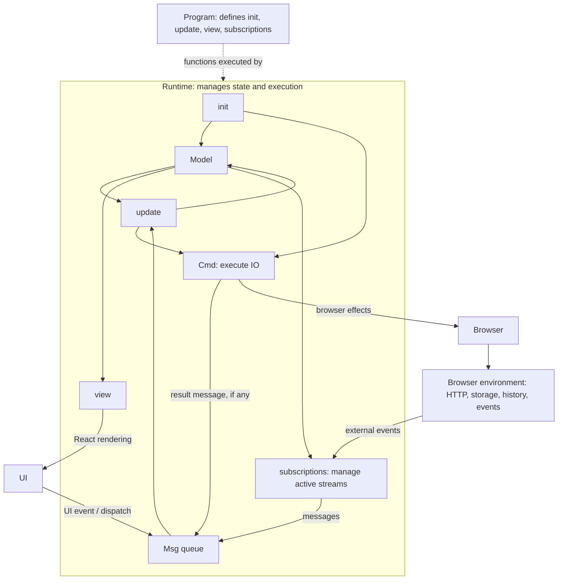

# Scalafui (Functional UI in Scala.js)

Scalafui is an experimental implementation of the Elm Architecture in Scala.js.

* [The Elm Architecture · An Introduction to Elm](https://guide.elm-lang.org/architecture/)
* [Functional UI \(Framework\-Free at Last\)](https://www.infoq.com/articles/functional-UI-introduction-no-framework/)

## Minimal Application Code

```scala
import org.scalajs.dom
import org.scalajs.dom.URL

import com.softwaremill.quicklens.*

import marubinotto.react.ReactNode
import marubinotto.react.html.*

import cats.effect.IO
import cats.effect.unsafe.implicits.global

import marubinotto.fui.*

object Main {

  case class Model(messages: Seq[String] = Seq.empty, input: String = "")

  def init(url: URL): (Model, Cmd[Msg]) = (Model(), Cmd.none)

  sealed trait Msg
  case class Input(input: String) extends Msg
  case object Send extends Msg

  def update(msg: Msg, model: Model): (Model, Cmd[Msg]) =
    msg match {
      case Input(input) =>
        (
          model.modify(_.input).setTo(input),
          Cmd.none
        )

      case Send =>
        (
          model
            .modify(_.messages).using(_ :+ model.input)
            .modify(_.input).setTo(""),
          Cmd.none
        )
    }

  def view(model: Model, dispatch: Msg => Unit): ReactNode =
    div(
      h1("Welcome to Scalafui!"),
      form(className := "message-input")(
        input(
          value := model.input,
          onInput := (e => dispatch(Input(e.currentTarget.value)))
        ),
        button(
          `type` := "submit",
          onClick := (e => {
            e.preventDefault()
            dispatch(Send)
          })
        )("Send")
      ),
      div(className := "messages")(
        model.messages.map(div(className := "message")(_))
      )
    )

  def main(args: Array[String]): Unit =
    run.unsafeRunAndForget()

  def run: IO[Unit] =
    IO.defer {
      Browser.run(
        dom.document.getElementById("app"),
        Program(init, view, update)
      )
    }
}
```

## Running examples

Requirements: [sbt](https://www.scala-sbt.org/), [Node.js](https://nodejs.org/)
22.22.2+ (22.x), 24.15.0+ (24.x), or 26+, and [Yarn Classic](https://yarnpkg.com/) 1.22.x.

Run `yarn` and `yarn dev` in the example directory. In a second terminal, start
`sbt` at the repository root and run the corresponding watch command:

| Example | Directory | sbt command | Demonstrates |
| --- | --- | --- | --- |
| [Hello World](src/main/scala/Main.scala) | `.` | `~fastLinkJS` | Model/View/Update |
| [ToDo](examples/todo/src/main/scala/todo/Main.scala) | `examples/todo` | `~exampleTodo/fastLinkJS` | TodoMVC |
| [Multipage](examples/multipage/src/main/scala/multipage/Main.scala) | `examples/multipage` | `~exampleMultipage/fastLinkJS` | Routing, HTTP, debounced search |
| [Feature Workspace](examples/feature-workspace/README.md) | `examples/feature-workspace` | `~exampleFeatureWorkspace/fastLinkJS` | Independent slots, nesting, outputs, async results |
| [Stopwatch](examples/stopwatch/src/main/scala/stopwatch/Main.scala) | `examples/stopwatch` | `~exampleStopwatch/fastLinkJS` | Subscriptions |
| [fuidungeon](examples/fuidungeon/README.md) | `examples/fuidungeon` | `~exampleFuidungeon/fastLinkJS` | Dungeon RPG with immutable state and random initialization |


## Core concepts

Scalafui separates an application's definition from its execution. `Program`
defines how state changes and how it is displayed. `Runtime` holds the current
state and runs the application. `Browser` provides effects for interacting with
the browser, such as HTTP requests, storage, and navigation.



UI events, command results, and subscriptions send messages to Runtime.
For each message, `update` returns a new Model and commands; `view` describes the UI.
Commands can use browser helpers or any other `IO` computation.

### Program

`Program[Model, Msg]` brings together the functions that describe an application:

```scala
Program(
  init = init,
  view = view,
  update = update,
  subscriptions = subscriptions,
  onUrlChange = Some(UrlChanged.apply)
)
```

The names on the right refer to application-defined functions and a message
constructor. Only `init`, `view`, and `update` are required. Subscriptions default
to `Sub.Empty`, and URL change handling defaults to `None`.

#### Model/View/Update

- **Model** is the application's state, usually an immutable case class.
- **Msg** describes something that happened, such as input, a button click, or a
  completed request.
- **View** turns the current Model into a `marubinotto.react.ReactNode`. Event handlers
  use the supplied `dispatch: Msg => Unit` to send messages.
- **Update** receives a message and the current Model, and returns the next Model
  together with commands to execute.

The application supplies these function signatures:

```scala
def init(url: URL): (Model, Cmd[Msg])
def view(model: Model, dispatch: Msg => Unit): ReactNode
def update(msg: Msg, model: Model): (Model, Cmd[Msg])
```

`init` receives the current browser URL and supplies the initial state and startup
commands. Keep state transitions in `update` and describe side effects as commands.
Return `Cmd.none` when no effect is needed. The minimal application above shows
this loop using input and send messages.

#### Commands

A `Cmd[Msg]` describes work for Runtime to execute once, optionally returning a
message. For example, an update can return a loading state and a command that
fetches data; the command's result becomes a new message that updates the state.

Compose effects with Cats Effect `IO`, then choose how to notify the application:

- `.toCmd` emits the computed value as a message. It is available through
  `import marubinotto.fui.*`; there is no implicit conversion.
- `Cmd.exec(io)` runs the effect without emitting a message.
- `Cmd.optional(io)` emits a message only when the result is `Some(message)`.
- `Cmd.none` is an empty batch of commands.

```scala
import cats.effect.IO
import marubinotto.fui.*
import scala.concurrent.duration.*

case class SearchCompleted(result: String)

def search(query: String): IO[String] = IO.pure(query) // Example computation.
def saveDraft: IO[Unit] = IO.unit

val operation = saveDraft *> search("scala")
val command = operation.map(SearchCompleted.apply).toCmd
val save = Cmd.exec(saveDraft)
val optional = Cmd.optional(search("scala").map(result =>
  Option.when(result.nonEmpty)(SearchCompleted(result))
))

val commands = Cmd.Batch(
  search("scala").map(SearchCompleted.apply).toCmd.debounce("search", 500.millis),
  save
)
```

Commands are lazy and preserve IO errors and cancellation. `.toCmd` emits the
computed value, including `None` or `Unit`; use `Cmd.optional` or `Cmd.exec` to
suppress those messages. Handle expected failures before conversion, for example
with `attempt.map(ResultReceived.apply).toCmd`.

`Cmd.fromFuture(expression)` evaluates its by-name argument on each execution
and emits `Either[Throwable, A]`. An already-created Future starts independently
and is reused. Canceling the command does not cancel the Future.

Compose dependent work with IO `flatMap`; use `sequence` / `parSequence` to collect
results. `Cmd.Batch` and `++` run commands independently, with no completion-order
guarantee. `map` transforms messages; `toNone` suppresses a single command's result.

Attach `.debounce(key, duration)` after composing the IO. A new command replaces
pending work with the same key, but does not cancel work already started. Keys
are shared across the Runtime. `map` and `toNone` preserve debounce; extracting
`.io` loses it. Zero or negative delays do not wait.

#### Subscriptions

A `Sub[Msg]` describes an external event source that Runtime should listen to
while it is needed. `subscriptions: Model => Sub[Msg]` selects those sources from
the current Model. Unlike a command, a subscription can keep producing messages
across many updates.

```scala
import marubinotto.fui.*
import scala.concurrent.duration.*

case class Model(running: Boolean)
case class Tick(epochMillis: Long)

def subscriptions(model: Model): Sub[Tick] =
  if (model.running) Sub.every(1.second, "clock").map(Tick.apply)
  else Sub.Empty
```

`Sub.every` emits Unix epoch milliseconds using `Clock[IO].realTime`.
`Sub.timeout(duration, msg, id)` emits once after a delay; `Sub.fromEvent` adapts
DOM events. Combine sources with `combine`, or use `Sub.Impl(id, stream)` for an
`fs2.Stream[IO, Msg]`.

For callback APIs, use `Sub.fromResource` with a registration resource:

```scala
import cats.effect.{IO, Resource}
import marubinotto.fui.*

def externalEvents[Msg](register: (Msg => Unit) => (() => Unit)): Sub[Msg] =
  Sub.fromResource[Msg]("external-events") { emit =>
    Resource.make(IO(register(emit)))(unregister => IO(unregister())).map(_ => ())
  }
```

Registration starts with the stream, retains events emitted during registration,
and releases resources when the stream ends, fails, or is canceled. Compose
multiple registrations with `Resource` to ensure cleanup on partial failure.

Runtime compares subscription IDs after each update: new IDs start streams and
removed IDs cancel them. Keeping an ID keeps its existing stream, even if the
new declaration supplies a different stream. To restart a completed or failed
source, remove its ID in one update before adding it again.

### Runtime and application lifetime

Runtime owns the Model, renders views, executes commands, and reconciles
subscriptions. `dispatch` queues messages for serial processing; commands run
independently. Startup initializes the Model, view, and subscriptions before
starting the initial command.

Use `Browser.run(container, program): IO[Unit]` for an application entry point.
For explicit lifetime management, `Browser.mount` returns
`Resource[IO, Runtime[Model, Msg]]`; `Runtime.make` provides the lower-level
resource without browser navigation integration.

```scala
Browser.mount(container, program).use { runtime =>
  IO.race(
    applicationLifetime,
    runtime.awaitFailure.flatMap(error => IO.raiseError[Unit](error))
  ).void
}
```

Keep the resource scope open while the UI should run. Release stops message
processing, cancels commands and subscriptions, waits for finalizers, removes
listeners, and unmounts React. Dispatch after release is ignored.

All three entry points accept `onError: RuntimeError => IO[Unit]`, defaulting to
console logging. Command and subscription failures are reported while other work
continues; failed subscriptions do not automatically restart. Normal cancellation
is not reported. Reporters must terminate without canceling themselves; reporter
failures fall back to console logging.

An update-loop failure stops message acceptance. `Browser.run` reports it and
raises the original exception, releasing resources. With `Browser.mount` or
`Runtime.make`, monitor `runtime.awaitFailure` and manage the scope yourself, as
above; `awaitFailure` only observes the cause. Startup errors fail acquisition.
React-internal asynchronous rendering errors require a React Error Boundary.

### Browser

`Browser.run` starts a Program in a DOM container and connects browser
navigation to its URL change handler. Cancel the returned IO to stop the application.

The other Browser helpers provide browser effects as lazy `IO` values. Compose
them first, then convert to commands when returning work from `init` or `update`:

```scala
import marubinotto.fui.*

case class DraftLoaded(value: Option[String])

val loadDraft = (
  Browser.setLocalStorage("draft", "hello") *>
    Browser.getLocalStorage("draft")
).map(DraftLoaded.apply).toCmd

val saveOnly = Cmd.exec(Browser.setLocalStorage("draft", "hello"))
```

The helpers cover these operations:

| Operations | Result inside IO |
| --- | --- |
| `pushUrl`, `replaceUrl`, `reload`, `setHtmlTheme` | `Unit` |
| `setLocalStorage`, `removeLocalStorage` | `Unit` |
| `getLocalStorage` | `Option[String]`; `None` for a missing key |
| `ajaxGetJson`, `ajaxGet`, `ajaxHead` | `Either` containing an error or the result |
| `encodeAsBase64`, `getCurrentPosition` | `Either` containing an API-specific error or the result |
| `decodeBase64` | `dom.Blob` |
| `createImage` | `dom.HTMLImageElement` |

HTTP, FileReader encoding, and geolocation report their asynchronous errors as
`Left` values, which can be mapped into messages. `ajaxHead` returns the response
even for a non-success HTTP status; inspect its status yourself. Image loading
and Base64 decoding begin only when the IO runs, and failures fail the IO.
`Browser.send(msg)` is also available to construct a command that emits a message.

Cancellation of HTTP helpers aborts fetch, including pending GET body reads;
cancellation of `encodeAsBase64` aborts its FileReader. These operations remain
canceled rather than emitting `Left`. Image loading and geolocation do not abort
their underlying operations.

## Features: composition beyond Elm Architecture

`Feature` is Scalafui's additional abstraction for composing stateful functionality.
It builds on Model/View/Update; it is not a requirement
of the Elm Architecture or a replacement for its pure state transitions. You can
continue building an application with the basic `Program` alone.

A feature can represent a page, an editor pane, a search panel, or a dialog.
Keep presentation-only components as ordinary view functions. Use a feature when
a part of the application has its own state transitions or work to manage.

### Definitions, registrations, and coexistence

- A **Feature** defines initialization, updates, and rendering. It can be reused
  without sharing state.
- A **FeatureSlots** group declares named logical slots with `slot(feature)`. Each slot
  holds at most one active instance of its registered Feature; registering the same
  Feature twice gives two independent slots. Slots identify places in the parent
  state, not positions in the DOM.
- A **policy** describes coexistence separately from registration. Children coexist
  by default. Each `exclusive(a, b, ...)` group permits at most one active member;
  different groups can be active simultaneously.
- A **FeatureBinding** connects the set's state, events, and outputs to its parent,
  and applies the supplied policy when initializing children.

All child Models remain in the parent's state tree. One Runtime processes the
messages; children do not create additional stores or message loops. Definitions
and bindings are stable values, not mutable stores. Features can contain nested
FeatureSlots groups. Neither the set nor its policy determines DOM placement or display order.

### Defining a feature

`Feature[Input, Context, Model, Msg, Out]` receives feature-specific initialization input.
Its `init` and `update` return `Transition(model, cmd, outputs)`; commands and
outputs default to empty. `Transition.unchanged(model)` is a convenient no-op.
Use `transition.andThen(model => nextTransition)` to compose transitions of the
same Model type. The callback runs immediately with the preceding Model; the
result retains both commands and both lists of outputs, in order. Message and
output types may widen to accommodate the next transition. Commands are combined
with `++`: this does not execute them or wait for one command to finish before
another starts.
Features can declare subscriptions, which are composed through bindings into the
App subscription declaration. Program and FeatureProgram also support App-owned sources.

`Msg` describes internal events. `Out` describes events the owner should handle.
For example, search can output `OpenWork(id)` without knowing whether its owner
will navigate to a page or open a side panel. Use `Nothing` when there are no outputs.

This small catalog example uses fixed data, so the composition is visible without
HTTP or routing code. Search emits a selection; Work displays it and emits a
request to go back.

```scala
import marubinotto.fui.*
import marubinotto.react.html.*

val catalog = Map("one" -> "Functional UI", "two" -> "Learning Scala")

object Search extends Feature[String, Unit, String, Search.Msg, Search.Out] {
  enum Msg {
    case QueryChanged(query: String)
    case Selected(id: String)
  }
  enum Out {
    case OpenWork(id: String)
  }

  def init(query: String, context: Unit): Transition[String, Msg, Out] = Transition(query)

  def update(msg: Msg, query: String, context: Unit): Transition[String, Msg, Out] = msg match {
    case Msg.QueryChanged(value) => Transition(value)
    case Msg.Selected(id) => Transition(query, outputs = List(Out.OpenWork(id)))
  }

  def view(query: String, context: Unit, dispatch: Msg => Unit) = div(
    input(value := query,
      onChange := (e => dispatch(Msg.QueryChanged(e.currentTarget.value)))),
    catalog.toSeq.sortBy(_._1)
      .filter { case (_, title) => title.toLowerCase.contains(query.toLowerCase) }
      .map { case (id, title) =>
        button(key := id, onClick := (_ => dispatch(Msg.Selected(id))))(title)
      }
  )
}

object Work extends Feature[String, Unit, String, Work.Msg, Work.Out] {
  enum Msg { case Back }
  enum Out { case Back }

  def init(id: String, context: Unit): Transition[String, Msg, Out] = Transition(id)

  def update(msg: Msg, id: String, context: Unit): Transition[String, Msg, Out] = msg match {
    case Msg.Back => Transition(id, outputs = List(Out.Back))
  }

  def view(id: String, context: Unit, dispatch: Msg => Unit) = div(
    h2(catalog.getOrElse(id, "Unknown work")),
    button(onClick := (_ => dispatch(Msg.Back)))("Back to search")
  )
}
```

### Providing current context

`Input` initializes an instance; `Model` holds its state; `Context` supplies
read-only external data on each `init`, `update`, and `view` call. Context is not
stored in child state, and changes alone do not invoke `update` or reinitialize it.

Declare a group's context with `FeatureSlots[Context]` and project it in `bind`
using `context = (model, parentContext) => ...`. Output handlers receive the
current parent context and accumulated Model. Events capture their destination,
but use the context current when handled. Commands retain values captured when
created. Adapt a narrower feature with
`slot(editor.mapContextFrom[AppContext](_.editor))`.

Use `Unit` when no context is needed. `FeatureProgram` uses `Unit` as its root
context; root bindings can derive child context from the current application
Model. `Feature.withoutContext` also omits context parameters from definitions:

```scala
val counter = Feature.withoutContext[Int, Int, Int, Nothing](
  init = initial => Transition(initial),
  update = (delta, count) => Transition(count + delta),
  view = (count, dispatch) =>
    button(onClick := (_ => dispatch(1)))(count.toString)
)
```

### Connecting a child to its parent

Register slots in a stable FeatureSlots definition. Each set has its own `State`,
`Event`, `Output`, `Slot`, and `Policy` types. Children and policies from another
set cannot be used in its binding.

`bind` allows children to coexist by default; omit `policy` or pass `Slots.policy()`
explicitly. Supply a policy with exclusive groups when children must replace each
other. The binding describes how to read and replace child state, wrap
and extract messages, and handle outputs. Register the resulting connection with
`withFeatures`. One binding connects all children in its set. You can chain calls
for separate sets, but the same set can be bound only once in a given parent.

The following connects Search and Work with an explicit exclusive policy. Without
that group (omit `policy` or use `Pages.policy()`), initializing Work would retain
Search's state too.

The output handler is a method, so it can refer to `pageBinding` without evaluating
it during binding construction. Returning to Search resets the query in this example:

```scala
import org.scalajs.dom.URL

object Pages extends FeatureSlots[Unit] {
  val search = slot(Search)
  val work = slot(Work)
}

case class Model(page: Pages.State = Pages.empty)

enum Msg {
  case PageEvent(event: Pages.Event)
}

def onPageOutput(output: Pages.Output, model: Model): Transition[Model, Msg, Nothing] =
  output match {
    case Pages.search.output(Search.Out.OpenWork(id)) =>
      pageBinding.init(model, Pages.work, id)
    case Pages.work.output(Work.Out.Back) =>
      pageBinding.init(model, Pages.search, "")
    case _ => Transition.unchanged(model)
  }

val pageBinding = Pages.bind[Model, Msg, Nothing](
  policy = Pages.policy(Pages.exclusive(Pages.search, Pages.work)),
  state = _.page,
  replace = (model, page) => model.copy(page = page),
  wrap = Msg.PageEvent.apply,
  extract = {
    case Msg.PageEvent(event) => Some(event)
  },
  onOutput = onPageOutput
)

val program = FeatureProgram[Model, Msg](
  init = (_: URL) => pageBinding.init(Model(), Pages.search, ""),
  update = (_, model) => Transition.unchanged(model),
  view = (model, dispatch) =>
    if (Pages.search.model(model.page).isDefined)
      pageBinding.view(model, Pages.search, dispatch, div())
    else
      pageBinding.view(model, Pages.work, dispatch, div("No page selected"))
).withFeatures(pageBinding).program
```

The single `withFeatures(pageBinding)` call connects both registered children.
Selecting a search result emits `OpenWork(id)`; the parent initializes Work. The Back
button emits `Work.Out.Back`; the parent initializes Search again.

Use `pageBinding.isActive(model, Pages.search)` to check whether a slot is active,
or `pageBinding.model(model, Pages.search)` to read its typed `Option[Search.Model]`.
Both queries read the supplied parent state without initializing the slot or
evaluating child context. Inactive slots return `false` and `None`, respectively.

Pass the resulting `Program` to `Browser.run`, `Browser.mount`, or `Runtime.make`
as usual. `FeatureProgram` also accepts `subscriptions` and `onUrlChange`.
For nesting, attach a connection to a `Feature` with `withFeatures` and register the
returned composed feature as a child in its parent's set.

Child events are intercepted by the connection and do not also execute the
parent's update. After updating the child, outputs are handled in list order,
with each handler seeing the previous handler's resulting parent Model. Initial
outputs follow the same rule, after the child has been installed. The completed
transition is rendered once. An output handler can remove or replace the child,
but commands already generated by that transition still execute. Their results
are ignored if the destination instance is no longer present.

`FeatureBinding.init`, `remove(model, child)`, and `clear(model)` return parent transitions.
`remove` removes only the specified child; `clear` removes all children in the set. When initializing several
children in one transition, use `andThen` to pass each resulting Model to the next
operation while preserving commands and outputs:

```scala
binding.init(model, Slots.first, firstInput)
  .andThen(next => binding.init(next, Slots.second, secondInput))
```

Prefer `FeatureBinding.init` for parent integration. The lower-level
`FeatureSlots.init(state, child, input, policy)` returns a set transition with
initial outputs.

### Multiple independent exclusive groups

A set can mix concurrent children with any number of independent exclusive groups:

```scala
object AppFeatures extends FeatureSlots[Unit] {
  val primarySearch = slot(Search)
  val primaryWork = slot(Work)
  val secondarySearch = slot(Search)
  val secondaryWork = slot(Work)
  val sidebarSearch = slot(Search)
}

val coexistence = AppFeatures.policy(
  AppFeatures.exclusive(AppFeatures.primarySearch, AppFeatures.primaryWork),
  AppFeatures.exclusive(AppFeatures.secondarySearch, AppFeatures.secondaryWork)
)
```

Pass `coexistence` to `AppFeatures.bind`. Initializing `primaryWork` removes only
`primarySearch`; it does not affect the secondary group or `sidebarSearch`.
Unlisted children coexist, so no `concurrent` declaration is needed.
Groups with fewer than two children, duplicate children, or overlapping membership
are rejected when constructing the group/policy. Policies do not change during a
binding's lifetime. Each `view` call names the child to render; render multiple
children to display them together, and choose layout and order in the parent.

### Sending messages to a child instance

Capture a child's current address for a deferred callback with `message`, or
return a command with `send`:

```scala
val back: Option[Msg] =
  pageBinding.message(model, Pages.work, Work.Msg.Back)
val backCommand: Cmd[Msg] =
  pageBinding.send(model, Pages.work, Work.Msg.Back)
```

Both capture the instance generation when called, without updating the child or
evaluating context. An inactive child yields `None` or `Cmd.none`. Messages use
the normal binding/output handling and the context current when processed.

### Feature subscriptions

A Feature can own sources alongside its state and commands:

```scala
override def subscriptions(model: Model, context: Context): Sub[Msg] =
  Sub.every(1.second, id = "tick").map(_ => Msg.Tick)
```

The default is `Sub.Empty`. With Unit context, `subscriptions(model)` is also
available. `Feature.withoutContext` accepts an optional `subscriptions` callback.
`withFeatures` combines the parent's own sources with all active children's
sources, and `FeatureProgram` forwards the composition to the ordinary Program.
App-owned subscriptions supplied to FeatureProgram are included once.

Bindings project current Context on each declaration; `mapContextFrom` also
adapts subscription context. Within one instance, retaining an ID retains the
existing stream and its captured values. Include changing source parameters in
the local ID when a context/model change should restart a source.

FeatureSlots automatically scope subscription IDs and debounce keys by slot and
generation at every parent-child boundary. The same local name can be reused by
siblings, separate groups, ancestors and descendants. Reinitializing a child or
ancestor changes its scoped IDs, stopping old subscriptions and starting new
ones on the next Runtime reconciliation. Removing, clearing, or exclusively
replacing a child removes its subscriptions. Hiding its view alone does not.

The core exposes generic `Sub.mapIds` and `Cmd.mapDebounceKeys` operations;
Runtime continues comparing plain strings. The `@feature:` prefix is reserved
for internal scoped keys: do not use it for App-level IDs/keys. The encoded
format is private, not a stable public identifier.

Feature scoping does not cancel debounce waits or running commands when a child
ends. Old and new generations have distinct keys, so a new generation does not
replace the old generation's wait. Both may execute external effects; stale
result messages are still ignored. Commands produced by a child's output handler
belong to the owning parent and receive that parent's scope, if it is itself a
registered child.

### App-level subscriptions

The App can inspect child state to decide which sources to subscribe to. This
extends the example with Escape-to-go-back, enabled only while Work is displayed:

```scala
import org.scalajs.dom

val keyboardProgram = program.copy(
  subscriptions = model =>
    Pages.work.event(model.page, Work.Msg.Back) match {
      case None => Sub.Empty
      case Some(back) =>
        Sub.fromEvent[dom.KeyboardEvent, Msg]("keydown", dom.window) { event =>
          Option.when(event.key == "Escape")(Msg.PageEvent(back))
        }
    }
)
```

This source captures the current Work instance's address. Returning to Search
removes its subscription from the App's declaration, so the existing Runtime
stops the source. This App-managed source remains supported alongside Feature-owned sources.

Keeping the same subscription ID keeps its existing stream, including its captured
destination. If you replace a child directly, use an App-managed visit/revision
in the subscription ID to rebind to the new address, or remove the ID in one
update before adding it again. Reconstructing a stream under the same ID does not
change its destination. App-managed subscription IDs and debounce keys remain shared within a Runtime;
the App must choose non-conflicting names for these operations. Feature-owned
sources and commands receive instance scopes automatically.

### Instance lifetime and asynchronous results

Initializing a slot creates a new instance, even with the same input. Exclusive
initialization removes peers; independent slots retain their state and identity.
Use `remove` or `clear` to preserve generation history. `empty` is only for initial
state, not for resetting an existing set.

Events target an instance generation. Removing or reinitializing a child makes
its earlier messages stale; routing ignores them without calling the child or
parent update. Nested sets check each level, so replacing an ancestor also
invalidates descendant messages.

**Removing a child does not cancel its commands or debounce waits.** They can
still perform external writes; only stale result messages are ignored. This also
applies when an initial output removes the child. Application shutdown cancels
work through Runtime's resource lifecycle.

Rendering through a slot or binding gives each instance its own React identity.
Reinitialization remounts the view and runs effect cleanup. Hiding a view discards
Hook state but preserves the child Model and event address; keep values that must
survive hiding in the Model. Calling `feature.view` directly omits this boundary.

Instance identity does not order requests within the same instance. Use an
application-level request serial when needed, as in the
[Multipage example](examples/multipage/src/main/scala/multipage/Main.scala),
which also demonstrates HTTP and URL routing.

## Routing

Routing connects the browser URL to application state, such as which page to
show. Scalafui includes `marubinotto.router`, a modified version of
[trail](https://github.com/sparsetech/trail), for matching and generating URLs.
The application decides what each route means for its Model.

```scala
import marubinotto.router.*

val search = Root & Param[String]("query")
val work = Root / "work" / Arg[String]()
val paged = work & Param[String]("query") & Param[Int]("page")

search.url("Scala + UI") // Right("/?query=Scala+%2B+UI")
paged.url(("123", "Scala", 2)) // Right("/work/123?query=Scala&page=2")
```

Use `Root` for the root path, `/` for literal segments or typed arguments, and
`& Param[A](name)` for query parameters. Patterns match relative URLs containing
a path, query, and optional fragment:

```scala
import org.scalajs.dom.URL

enum Page {
  case Search(query: String)
  case Work(id: String)
  case NotFound
}

def pageFromUrl(url: URL): Page =
  (url.pathname + url.search + url.hash) match {
    case search(query) => Page.Search(query)
    case Root(_)       => Page.Search("")
    case work(id)      => Page.Work(id)
    case _             => Page.NotFound
  }
```

Call this routing function from `init` to choose the initial page. Define a
message such as `UrlChanged(url: URL)`, pass `onUrlChange = Some(UrlChanged.apply)`
to Program, and handle that message in `update` by selecting the new page.
See the [Multipage example](examples/multipage/src/main/scala/multipage/Main.scala)
for a complete application with page-specific models and commands.

With `Browser.run` or `Browser.mount`, `Browser.pushUrl(url)` adds a history entry without
loading a new document and notifies the URL change handler. Browser back/forward
navigation also reaches that handler through `popstate`. `pushUrl(url, notify =
false)` suppresses its notification; `replaceUrl(url)` replaces the current
history entry without notifying the handler.

`RoutePattern.url(value)` returns `Either[RouteError, String]`. Handle errors
explicitly or lift the result into IO before navigating:

```scala
import cats.effect.IO
import marubinotto.fui.*

val openWork = Cmd.exec(
  IO.fromEither(work.url("123")).flatMap(url => Browser.pushUrl(url))
)
```

`PathArgumentRejected` and `QueryParameterRejected(name)` report a Codec returning
`None`; `EncodingFailed(underlying)` preserves an exception from encoding.
Lifting a `Left` into IO fails the command; map errors to application messages
instead if they should be displayed in the UI.

Parsing returns `Option` and supports pattern matching as above. Required query
parameters must be present and decode successfully; empty strings are valid.
The first repeated value wins, unknown parameters and fragments are ignored,
and path-only routes also match URLs with queries. Order more specific query
patterns before path-only fallbacks. Both path arguments and query values use
`Codec`; query encoding follows `URLSearchParams`.

## Tests

Run `yarn install` at the repository root, then `sbt test`. Runtime tests use
jsdom 30 and require the Node.js versions listed above; browser command tests
stub storage and fetch. Tests run serially because they install temporary
browser globals.

## React facade

`marubinotto.react` provides the React 19 client API used by Scalafui and its
examples. `ReactNode` describes renderable content; `ReactElement` describes an
actual element. HTML builders are immutable and reusable:

```scala
import marubinotto.react.*
import marubinotto.react.html.*

val component = FunctionalComponent[String] { label =>
  val (count, setCount) = Hooks.useState(0)
  button(onClick := (_ => setCount.update(_ + 1)))(s"$label: $count")
}
```

Use `setCount(value)` to set a value and `setCount.update(previous => next)` to
update from previous state. Function-valued state is stored without invoking it.
`useEffect` and `useLayoutEffect` accept a callback returning either `Unit` or a
cleanup function. Omitting dependencies runs after each commit; `Seq.empty`
runs on mount; a dependency sequence uses React's `Object.is` comparison.
Hooks must follow React's rules: call them unconditionally at the top level of
a component or custom Hook.

For DOM refs, use `Hooks.useDomRef[dom.HTMLDivElement]()` and inspect `.value`,
which is `None` before mounting and after unmounting. `Hooks.useRef(initial)` is
for mutable values. `ref.cleanup[T](node => cleanup)` supports React 19 ref
cleanup. Event `currentTarget` has the registered element's type; `target` is
an `EventTarget` and may be a descendant.

### External JavaScript components

Use a case class with `derives PropsEncoder` for external props. Nested products
must also have a `PropsEncoder`. Scala components do not encode their props.
`None` and `js.undefined` omit a property; `Nullable.Null` explicitly sends null.
Primitives, sequences, JS values, React nodes, refs, and Scala callbacks with up
to two arguments are supported. Unsupported fields or callback arguments fail
at compile time with the field name. Provide a manual `PropsEncoder` for a
special external representation. JS facade declarations remain responsible
for describing the external library accurately.

```scala
case class Options(label: String, enabled: Boolean) derives PropsEncoder
case class Props(options: Options, title: Option[String] = None)
    derives PropsEncoder
```

`React.component` adapts a renderer accepting native JS props into a JS React
function component. `ReactNode.fromJs` / `ReactNode.toJs` are explicit boundaries
for trusted React values returned by JavaScript libraries. They do not validate
arbitrary JavaScript objects as renderable nodes.

### Development

React and React DOM are pinned together at 19.3.1. Vite reloads the page after
Scala.js output changes; Model and Hook state are reset. Fast Refresh is not
implemented. SSR, Server Components, Actions, and unused React APIs are outside
this facade's current scope.
